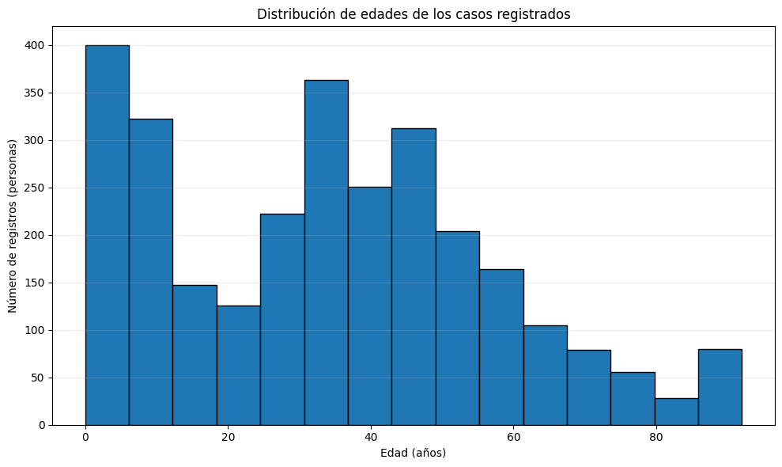
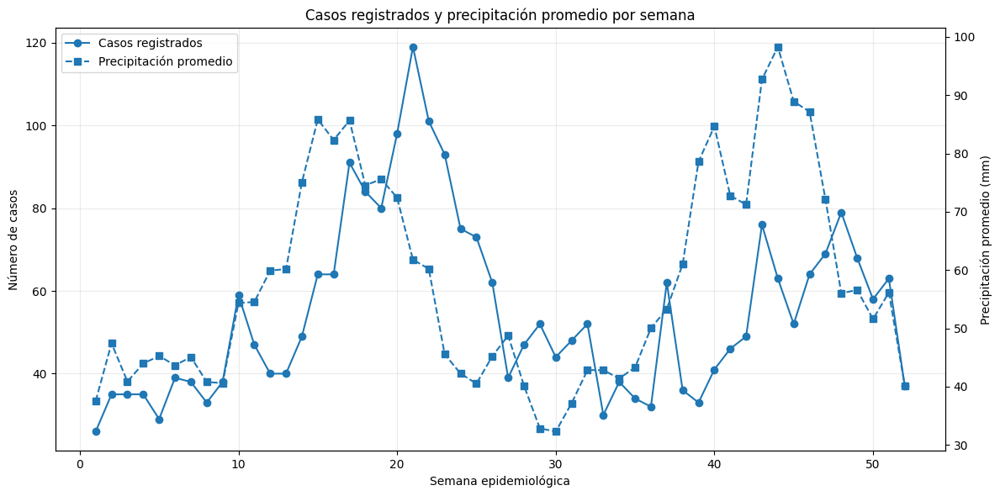
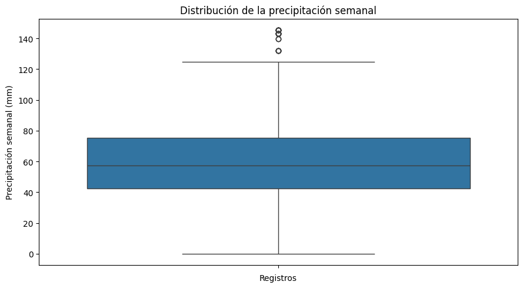
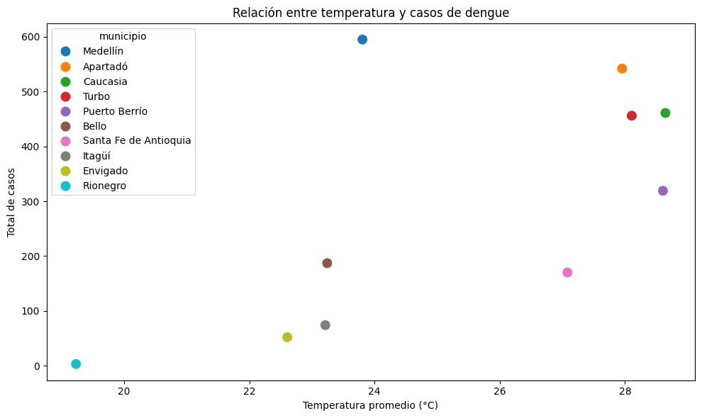
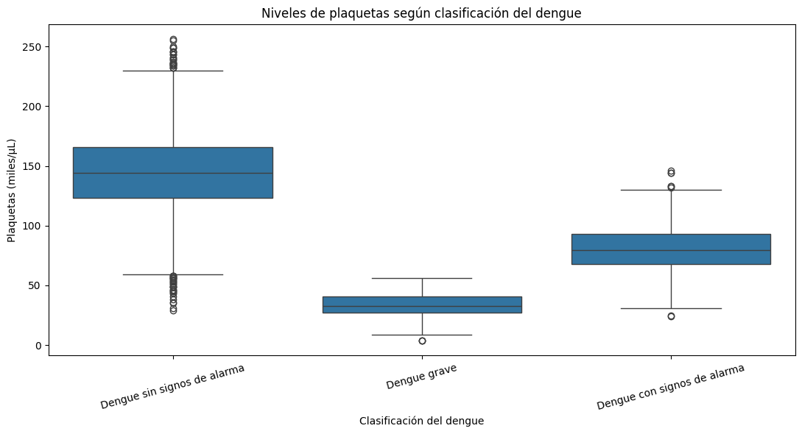
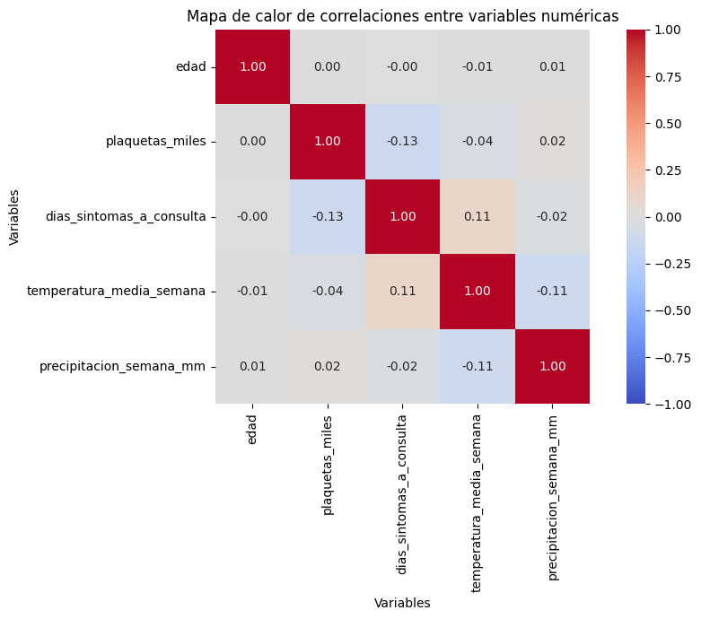

# Proyecto integrador — Grupo 1: Análisis de casos de dengue en Antioquia durante 2025

## Integrantes

- SEBASTIAN RINCON RODRIGUEZ
- MARIA CAMILA VALLEJOS BASANTE

## Descripción del proyecto

Este proyecto desarrolla un análisis exploratorio de un conjunto de datos sintéticos sobre casos notificados de dengue durante 2025 en diez municipios de Antioquia. El propósito es identificar patrones temporales, territoriales, demográficos y clínicos que permitan formular recomendaciones académicas para orientar acciones de prevención y atención.

**Importante:** los registros son sintéticos. No representan notificaciones reales ni permiten estimar la incidencia real del dengue en Antioquia.

## El conjunto de datos

El archivo `data/salud_dengue_antioquia_2025.csv` contiene inicialmente **2.859 registros y 18 columnas**. Cada fila representa un caso notificado dentro del conjunto sintético. Las variables incluyen información demográfica, geográfica, clínica y ambiental.

Después del proceso de limpieza se conservaron **2.859 filas y 17 columnas**. Se eliminó la variable `ocupacion` por su elevada proporción de valores faltantes.

### Principales variables

| Variable | Tipo | Descripción |
|---|---|---|
| `fecha_notificacion` | Fecha | Fecha de notificación del caso |
| `semana_epidemiologica` | Numérica | Semana epidemiológica de notificación |
| `municipio` | Categórica | Municipio asociado al caso |
| `subregion` | Categórica | Subregión de Antioquia |
| `zona` | Categórica | Zona urbana o rural |
| `sexo` | Categórica | Sexo registrado del paciente |
| `edad` | Numérica | Edad en años |
| `regimen_salud` | Categórica | Régimen de afiliación en salud |
| `dias_sintomas_a_consulta` | Numérica | Días entre el inicio de síntomas y la consulta |
| `clasificacion` | Categórica | Clasificación clínica del dengue |
| `plaquetas_miles` | Numérica | Recuento de plaquetas, expresado en miles/µL |
| `hospitalizado` | Categórica | Indica si el paciente fue hospitalizado |
| `dias_hospitalizacion` | Numérica | Días de hospitalización, cuando aplica |
| `condicion_final` | Categórica | Condición final registrada |
| `temperatura_media_semana` | Numérica | Temperatura media semanal, en °C |
| `precipitacion_semana_mm` | Numérica | Precipitación semanal, en milímetros (mm) |

### Decisión que apoya

El análisis busca aportar elementos descriptivos para identificar municipios y periodos que, dentro de este conjunto sintético, concentran más notificaciones, así como diferencias entre grupos clínicos y demográficos. Los resultados pueden servir como ejercicio para discutir dónde priorizar campañas de prevención, vigilancia y acceso oportuno a la atención; no constituyen evidencia epidemiológica real.

## Preguntas de análisis

1. ¿Cómo evolucionan los casos semana a semana y qué patrón descriptivo se observa frente a la precipitación?
2. ¿Qué municipios y subregiones concentran más notificaciones y cómo se relacionan con la temperatura?
3. ¿Cómo varían los niveles de plaquetas según la clasificación del dengue?
4. ¿Qué diferencias se observan en el tiempo hasta la consulta según la clasificación clínica y la zona de residencia?
5. ¿Cómo se distribuyen las edades y los casos registrados por sexo?
6. ¿Qué asociaciones exploratorias se observan entre las variables numéricas seleccionadas?

## Calidad de los datos y limpieza

El conjunto inicial tenía 2.859 filas y 18 columnas. Durante la revisión se identificaron valores faltantes y algunos valores atípicos que requerían tratamiento.

| Variable o situación | Hallazgo | Decisión de limpieza |
|---|---|---|
| `dias_hospitalizacion` | 2.260 valores faltantes (79,05 %), asociados a personas no hospitalizadas | Se conservaron como faltantes estructurales; no se imputaron porque el dato no aplica a esos casos |
| `ocupacion` | 1.946 valores faltantes (68,07 %) | Se eliminó la columna por su alta proporción de datos faltantes |
| `plaquetas_miles` | 420 valores faltantes (14,69 %) | Se imputaron con la mediana según la clasificación clínica |
| `regimen_salud` | 183 valores faltantes (6,40 %) | Se conservaron como faltantes |
| `dias_sintomas_a_consulta` | 156 valores faltantes (5,46 %) | Se conservaron como faltantes |
| `precipitacion_semana_mm` | 108 valores faltantes (3,78 %) | Se imputaron con la mediana por municipio |
| `edad` | 98 valores faltantes iniciales (3,43 %) y tres edades superiores a 110 años | Las tres edades sospechosas (120, 135 y 135) se trataron como faltantes; luego se imputó la mediana por sexo |
| Demoras de consulta | Tres valores superiores a 30 días (45, 60 y 45) | Se conservaron porque no había evidencia suficiente para declararlos imposibles |

No se eliminaron filas. La tabla final de trabajo quedó con **2.859 registros y 17 columnas**. La fecha de notificación se convirtió al tipo fecha para permitir el análisis temporal.

Los valores faltantes que permanecen en la tabla final corresponden principalmente a `dias_hospitalizacion`, `regimen_salud` y `dias_sintomas_a_consulta`. Las decisiones y transformaciones se implementan y documentan en el notebook `notebooks/analisis.ipynb`.

## Hallazgos del análisis

### 1. Evolución semanal y precipitación

La semana epidemiológica 21 presentó el mayor número de notificaciones, con **119 casos**. La gráfica temporal permite comparar la evolución semanal de los registros con la precipitación semanal agregada a partir de combinaciones únicas de municipio y semana.

**Interpretación:** se identifica un máximo de notificaciones en la semana 21. La comparación con la precipitación sirve para explorar patrones temporales, pero no demuestra que la lluvia haya causado cambios en los casos.

### 2. Distribución territorial y temperatura

Los municipios con mayor número de registros fueron **Medellín (595), Apartadó (542) y Caucasia (461)**. Por subregión, Urabá reunió **998 notificaciones**. En el análisis agregado por municipio, la correlación exploratoria entre temperatura media y cantidad de casos fue de **0,657**, calculada sobre solo diez municipios.

**Interpretación:** los registros se concentran en determinados municipios y subregiones. La correlación municipal debe interpretarse con cautela por el tamaño reducido de la muestra agregada y porque una asociación no implica causalidad.

### 3. Plaquetas y clasificación clínica

El promedio de plaquetas fue de **144,02 miles/µL** para dengue sin signos de alarma, **80,26 miles/µL** para dengue con signos de alarma y **33,10 miles/µL** para dengue grave.

**Interpretación:** en este conjunto sintético, el promedio de plaquetas disminuye entre las categorías de mayor gravedad. La gráfica permite comparar distribuciones, pero no sustituye la valoración clínica ni establece por sí sola un diagnóstico.

### 4. Tiempo hasta la consulta

El promedio de días entre el inicio de síntomas y la consulta fue de **5,16 días** en dengue grave, **4,76 días** en dengue con signos de alarma y **3,51 días** en dengue sin signos de alarma. Por zona, el promedio fue de **4,91 días** en registros rurales y **3,29 días** en urbanos.

**Interpretación:** se observan mayores tiempos promedio en los grupos grave y rural. Este patrón descriptivo puede motivar preguntas sobre oportunidad y acceso a la atención, pero no permite concluir que la demora haya causado una clasificación más grave.

### 5. Distribución de edades

El histograma permite observar la concentración y dispersión de las edades de los registros. En los datos limpiados, la edad media es aproximadamente **34,3 años** y la mediana es **34 años**.

**Interpretación:** la distribución resume las edades presentes en los registros sintéticos. Puede ayudar a describir los grupos representados, pero no permite inferir el riesgo de enfermar por edad sin datos poblacionales de referencia.

### 6. Casos registrados por sexo

La gráfica de barras compara el número de registros de cada categoría de sexo.

**Interpretación:** permite identificar cómo se distribuyen los registros entre las categorías disponibles. Las diferencias en cantidades no deben interpretarse como diferencias de riesgo sin conocer el tamaño poblacional de cada grupo.

### 7. Distribución de la precipitación y correlaciones

El diagrama de caja resume la distribución de la precipitación semanal registrada. El mapa de calor presenta correlaciones entre variables numéricas seleccionadas, como edad, plaquetas, días hasta la consulta, temperatura y precipitación.

**Interpretación:** ambas visualizaciones sirven para reconocer dispersión, posibles valores extremos y asociaciones lineales exploratorias. Las correlaciones no prueban causalidad y pueden verse afectadas por datos faltantes, imputaciones y la estructura sintética del conjunto.

## Visualizaciones

Las siguientes imágenes son generadas por el notebook y se guardan en `visualizaciones/`.

### 1. Distribución de edades



El histograma muestra cómo se distribuyen las edades de los registros. La media es aproximadamente 34,3 años y la mediana 34 años; esto describe la muestra sintética, no la población de Antioquia.

### 2. Casos registrados por sexo


La gráfica compara la cantidad de registros por sexo. La diferencia entre barras describe la composición del conjunto y no equivale a una comparación de riesgo poblacional.

### 3. Distribución de precipitación



El diagrama de caja resume la dispersión y los valores extremos de la precipitación semanal disponible. La precipitación aparece asociada a registros de casos, por lo que esta vista es descriptiva y no representa observaciones independientes por paciente.

### 4. Casos semanales y precipitación



La gráfica compara los casos por semana epidemiológica con la precipitación semanal agregada. La semana 21 registra el máximo de casos (119); la comparación temporal permite explorar coincidencias y desfases, sin establecer causalidad.

### 5. Temperatura y casos por municipio



El diagrama de dispersión relaciona temperatura media y cantidad de registros por municipio. La correlación exploratoria es 0,657 para diez municipios, por lo que debe interpretarse con cautela y no como una relación causal.

### 6. Plaquetas según clasificación



El diagrama de cajas compara el recuento de plaquetas entre clasificaciones. Los promedios son 144,02, 80,26 y 33,10 miles/µL, respectivamente, desde dengue sin signos de alarma hasta dengue grave.

### 7. Mapa de calor de correlaciones



El mapa de calor permite comparar la dirección e intensidad de las correlaciones entre variables numéricas. Estas asociaciones son exploratorias y no permiten afirmar que una variable cause cambios en otra.

## Conclusiones y recomendaciones

1. **Priorizar la revisión territorial de los registros:** Medellín, Apartadó y Caucasia concentran las mayores cantidades de casos del conjunto. Para un ejercicio de planeación, conviene considerar estos municipios al diseñar campañas y revisar la distribución territorial de los registros. Esto no significa que sean necesariamente los municipios con mayor incidencia real.
2. **Examinar los periodos de mayor concentración:** la semana epidemiológica 21 presentó 119 notificaciones. Se recomienda usar la evolución semanal como insumo para planear y evaluar actividades de prevención en el escenario académico, sin asumir que la precipitación explica por sí sola los cambios.
3. **Promover la consulta oportuna y estudiar barreras de acceso:** los promedios de demora fueron mayores en registros rurales (4,91 días) que en urbanos (3,29 días). Se recomienda investigar, con datos reales y representativos, posibles barreras de acceso y estrategias de orientación para consultar tempranamente.
4. **Usar las variables clínicas como apoyo descriptivo, no diagnóstico:** las diferencias de plaquetas entre clasificaciones justifican explorar la información clínica, pero cualquier decisión asistencial debe basarse en protocolos y valoración profesional, no en este conjunto sintético.
5. **Mejorar la calidad de futuros datos:** documentar los faltantes estructurales, las reglas de validación y los métodos de imputación, y disponer de denominadores poblacionales si se desea comparar tasas de incidencia entre municipios o grupos.

## Limitaciones

- **Datos sintéticos:** los registros no son datos oficiales ni representan la situación epidemiológica real de Antioquia durante 2025.
- **Sin denominadores poblacionales:** se comparan cantidades de registros, no tasas de incidencia. Un municipio con más registros no necesariamente tiene mayor riesgo.
- **Valores faltantes e imputaciones:** algunas variables conservan datos faltantes y otras fueron imputadas mediante medianas. Esto puede influir en distribuciones y correlaciones.
- **Grupos pequeños:** la comparación de temperatura y casos se realiza sobre diez municipios, por lo que la correlación es exploratoria y sensible a pocos puntos.
- **Correlación no implica causalidad:** las asociaciones observadas no demuestran que la lluvia, la temperatura, la demora en consultar u otra variable cause la cantidad o gravedad de los casos.
- **Datos agregados y repetidos:** algunas variables ambientales corresponden a municipio y semana, por lo que pueden repetirse en múltiples registros individuales. Para el análisis semanal de precipitación se agregaron combinaciones únicas de municipio y semana.
- **Alcance descriptivo:** los resultados permiten explorar patrones del conjunto disponible, pero no generalizar a toda la población ni formular conclusiones clínicas o epidemiológicas reales.

## Estructura del repositorio

```text
proyecto-integrador-pc-grupo-1/
├── data/
│   └── salud_dengue_antioquia_2025.csv
├── notebooks/
│   └── analisis.ipynb
├── visualizaciones/
│   ├── 01-distribucion-de-edades.png
│   ├── 02-casos-por-sexo.png
│   ├── 03-distribucion-precipitacion.png
│   ├── 04-casos-semanales-y-precipitacion.png
│   ├── 05-temperatura-y-casos-por-municipio.png
│   ├── 06-plaquetas-segun-clasificacion.png
│   └── 07-mapa-calor-correlaciones.png
└── README.md
```

## Ejecución del análisis

1. Abrir `notebooks/analisis.ipynb` en Google Colab o Jupyter Notebook.
2. Ejecutar las celdas en orden. El notebook carga el CSV desde la URL pública del repositorio en GitHub, por lo que no es necesario descargarlo manualmente en el equipo.
3. Al finalizar, las gráficas se exportan a la carpeta `visualizaciones/`.

**Archivo de datos:** `data/salud_dengue_antioquia_2025.csv`
